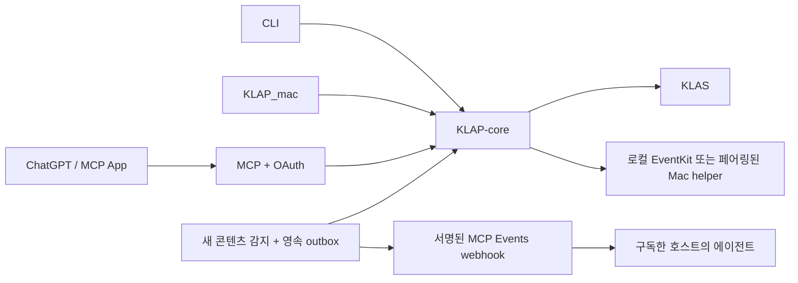

# KLAP for GPT

KLAS를 ChatGPT의 도구와 앱 화면으로 연결하는 개인용 플러그인이다. CLI,
KLAP_mac, 이 서버는 동일한 **KLAP-core**를 사용한다. KLAS 인증·파싱·조회·수강·
Apple 동기화 정책은 `core/`에 있고, 이 저장소에는 MCP, OAuth, Events, UI와
설치 방식별 어댑터만 둔다. 기존 Go 모듈 경로 `github.com/leehyowon14/KLAP-cli`는
호환성을 위해 유지한다.



## 지원 범위

- 학기·과목, 공지·상세, 과제·상세, 온라인 강의, 마감, 요일×교시 시간표,
  출석, 학사일정, 통합 검색.
- React MCP App의 대시보드와 텍스트 도구 응답. MCP Apps가 없는 호스트도 조회 가능.
- 사용자 요청에 따른 순차 수강 작업, 안정적인 강의 ID, 멱등 요청과 취소.
  재시작 당시 미완료 작업은 `interrupted`로 끝나며 자동 재실행하지 않는다.
- `notice.created`, `assignment.created`, `lecture.created` MCP Events.
- Mac 모드에서는 과제·강의→미리알림, 시간표·학사일정→캘린더 동기화.
  충돌은 현재 값 유지(`keep`) 또는 학교 변경 적용(`apply`) 선택으로 처리한다.

인스턴스 하나에는 소유자와 KLAS 계정 하나를 연결한다. 기존 계정 변경 전 연결을 해제한다.
다운로드·전사·강의평가·예약 수강은 플러그인 도구에 포함하지 않으며, 기존 CLI와
KLAP_mac의 해당 기능은 공통 코어에 보존한다.

## 설치 방식

| 방식 | 실행 환경 | 자격증명 | Apple 동기화 |
| --- | --- | --- | --- |
| `server` | Docker Compose, 소스 빌드 | 암호화된 인스턴스 저장소 | 도구 미노출 |
| `mac` | macOS 네이티브 Go·Swift | 기존 KLAP Keychain | 로컬 EventKit |
| `hybrid` | Docker 서버 + Mac helper | 서버 저장소, helper 토큰은 Mac Keychain | 연결된 Mac에서만 실행 |

호스팅형 ChatGPT 연결에는 접근 가능한 HTTPS origin이 필요하다. 이 저장소에는
GitHub Actions 빌드 파이프라인이 없다. 설치하는 하드웨어에서 직접 빌드한다.

### 서버

Docker Engine과 Compose v2가 필요하다. `core/`가 비어 있다면 먼저 다음을 실행한다.

```sh
git submodule update --init --recursive
cp .env.example .env
# .env의 KLAP_PUBLIC_URL과 충돌하지 않는 KLAP_PORT 설정
docker compose up -d --build
docker compose ps
```

컨테이너는 UID 10001로 실행되고 데이터는 `klap-gpt_data` 볼륨에 저장된다.
서비스 포트는 loopback에만 연결한다. `deploy/nginx.conf`의 도메인과 포트를 맞춰
기존 HTTPS 프록시 뒤에 연결한다. 참조 배포는 nginx의 HTTP 80번과 기존 Cloudflare
터널을 사용한다. WebSocket 경로도 프록시해야 hybrid helper가 연결된다.

### 최초 소유자 설정과 KLAS 연결

1. 설치한 HTTPS 주소의 `/login`을 연다.
2. 설치 토큰을 아래 명령으로 **본인 터미널에서** 확인하고, 화면에서 소유자 암호를 정한다.
3. 대시보드의 **연결 설정**에서 학번과 KLAS 암호를 입력한다.
4. 플러그인의 연결 흐름에서 같은 개인 인스턴스에 로그인하고 OAuth 접근을 허용한다.

```sh
docker compose exec -T klap cat /data/bootstrap.token
```

설치 토큰은 최초 설정 때만 유효하다. 암호를 채팅이나 MCP 도구 인수로 전달하지 않는다.
MCP endpoint는 `/mcp`이며 OAuth Authorization Code, PKCE S256, DCR를 지원한다.
도구 접근 권한은 `klap` scope이다. OAuth 메타데이터는 표준 `.well-known` 경로에 있다.

### Mac 네이티브 설치

Go 1.26.4, Node.js 24, Xcode Command Line Tools의 Swift, Python 3가 필요하다.

```sh
bash scripts/build-mac.sh mac
bash scripts/install-mac.sh mac https://your-klap.example
```

앱은 기본적으로 `~/Applications/KLAP for GPT.app`에 설치되고 LaunchAgent가
로그인 시 실행한다. HTTP는 `127.0.0.1:3030`을 사용한다. 해당 Mac까지 전달하는
HTTPS 프록시는 별도로 구성해야 한다. 소유자 상태는
`~/Library/Application Support/KLAP-for-GPT`에 저장된다.
KLAS 계정은 기존 KLAP 설정과 Keychain을 사용하며, 최초 Apple 동기화 때 시스템
권한 승인이 필요하다. 여러 KLAS 계정이 등록되어 있으면 기존 CLI에서 사용할 계정을 선택한다.

### 혼합 설치

서버 `.env`를 `KLAP_MODE=hybrid`로 바꾸고 `docker compose up -d`를 실행한다.
서버의 **연결 설정 → 내 Mac 연결**에서 5분간 유효한 일회용 코드를 발급한다.

```sh
bash scripts/install-mac.sh helper https://your-klap.example
```

설치 프로그램의 입력창에 코드를 넣는다. helper는 토큰을 Keychain에 저장하고
서버로 outbound WSS 연결을 유지한다. Mac의 inbound 포트는 열지 않는다.
허용된 작업은 미리알림·캘린더 동기화와 카테고리 조회뿐이다. 임의 실행 경로나
명령은 전달할 수 없다. 연결이 끊기면 진행 중인 요청은 실패하며, 오프라인 작업을
큐에 보관하거나 재연결 후 자동 재실행하지 않는다.

## MCP Events

지원 호스트에서 다음과 같이 요청한다.

> 2026년 2학기 새 공지, 과제, 온라인 강의를 감지하면 이 대화에서 과목과 마감일을 알려줘.

호스트가 `events/list`로 정의를 읽고 `events/subscribe`에 callback URL과 signing
secret을 제공한다. 사용자는 webhook 주소나 키를 직접 만들 필요가 없다.
필수 필터 `term`은 `2026-2` 형태이며 `course_id`로 과목을 좁힐 수 있다.

- MCP2 `2026-07-28`, `server/discover`, Events capability와 세 가지 이벤트 메서드 지원.
- 첫 정상 조회는 기준선만 저장한다. 이후 5분 간격으로 새 stable ID를 감지한다.
  조회수·진도·제출 상태나 기존 글 수정은 새 콘텐츠 이벤트가 아니다.
- 부분 조회 실패 시 기준선을 갱신하지 않는다. 기준선과 outbox를 함께 영속화한다.
- 공개 HTTPS callback만 허용하고 challenge 검증 후 Standard Webhooks 서명을 붙인다.
  중복 전달 가능성을 고려해 같은 `eventId`를 유지한다.
- 기본 구독 유효기간 24시간, 요청에 따라 1분~7일. 호스트가 `refreshBefore` 전에
  갱신해야 한다. 구독 해제·권한 폐기·계정 변경 후 전달하지 않는다.
- 일시적 전송 오류는 최대 8회 재시도한다. 영구 오류와 HTTP 410은 중지한다.
  과거 이벤트 cursor 재생은 지원하지 않는다.
- 화면의 **호스트 수신**은 HTTP 성공 응답까지 확인한 상태이다. 에이전트가 실제
  실행됐는지는 구독한 채팅에서 별도로 확인한다.

[OpenAI MCP Events 문서](https://developers.openai.com/plugins/build/mcp-events)는
ChatGPT Work 웹·Cloud 모드·dots 지원을 명시한다. 로컬 Codex 채팅에서 자동 호출이
된다고 가정하지 않는다. 호스트가 지원하지 않으면 조회 도구와 앱 화면을 사용한다.

## 개발과 검증

```sh
go test -race -timeout 90s ./...
(cd core && go test -race -timeout 90s ./internal/app ./pkg/core)
(cd web && npm ci && npm run build && npm test)
node web/test/preview.mjs
```

미리보기는 `127.0.0.1:4173`에서만 실행하며 **UI 검증용 예시 데이터** 표시가 있다.
실제 KLAS 계정이나 운영 작업을 사용하지 않는다. 실제 검증 범위는
[IMPLEMENTATION.md](IMPLEMENTATION.md)에 별도로 기록한다.

코어를 바꿀 때는 `core/`에서 변경과 테스트를 커밋하고 해당 커밋을 원격에 올린 뒤,
이 저장소의 submodule과 KLAP_mac의 `Bridge/core-ref`를 같은 SHA로 갱신한다.
KLAP_mac의 별도 패치 파일이나 중복 Go 브리지로 동작을 수정하지 않는다.

## 운영과 복구

`docker compose logs --tail 100 klap`으로 상태를 확인하고 `/health`로 실행 상태를 확인한다.
상태 볼륨에는 OAuth, 구독, outbox, 작업 기록, 암호화된 KLAS 자격증명이 있다.
`master.key`와 암호화된 상태 파일을 **같은 백업**으로 보관한다. 키를 잃으면 기존
상태를 복호화할 수 없다. 백업은 컨테이너를 중지한 뒤 볼륨 전체를 복사한다.
키와 백업을 저장소에 커밋하지 않는다.

되돌릴 때는 이전 소스와 코어 SHA로 `docker compose up -d --build`를 실행한다.
`docker compose down`은 볼륨을 남기지만 **`down -v`는 사용하지 않는다**.
Mac 설치기는 기존 앱을 `.previous.<timestamp>`로 남긴다. 해당 LaunchAgent를
`launchctl bootout gui/$(id -u)/dev.leehyowon14.klap.gpt.mac` 또는 `.helper`로
중지한 뒤 이전 앱으로 되돌릴 수 있다.
