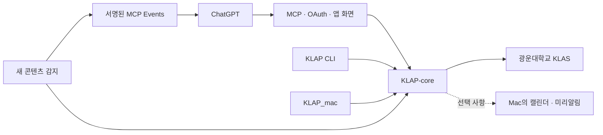

<p align="center">
  
</p>

<h1 align="center">KLAP for GPT</h1>

<p align="center">
  <strong>나의 KLAS와 새 소식을 ChatGPT에서 한곳에.</strong><br />
  공지·과제·강의 조회부터 새 콘텐츠 알림까지, 직접 운영하는 개인 학습 도우미
</p>

<p align="center">
  <a href="#features">주요 기능</a> ·
  <a href="#quick-start">설치하기</a> ·
  <a href="#chatgpt">ChatGPT 연결</a> ·
  <a href="#events">새 소식 알림</a> ·
  <a href="#troubleshooting">문제 해결</a> ·
  <a href="#development">개발 참여</a>
</p>

**KLAP for GPT**는 광운대학교 학습 시스템 **KLAS**를 ChatGPT의 도구와 앱 화면에 연결합니다.
본인 서버에 KLAS 계정을 연결하면 대화로 학습 정보를 조회하고, 대시보드에서 일정과 진행 상태를 확인할 수 있습니다.
ChatGPT가 외부 서비스의 기능을 호출하는 연결 규격인 **MCP**를 사용합니다.

**라즈베리 파이나 Linux 서버 한 대만으로 사용할 수 있습니다.** 기본 설치에는 Mac이 필요하지 않습니다.
Mac은 Apple 캘린더·미리알림 연동을 추가하거나 서버를 Mac에서 직접 실행할 때만 사용합니다.
현재는 **인스턴스당 소유자 1명, KLAS 계정 1개**를 지원합니다.

<a id="features"></a>

## 주요 기능

| 기능 | 할 수 있는 일 |
| --- | --- |
| 학습 정보 조회 | 학기·과목, 공지와 상세 내용, 과제와 상세 내용, 온라인 강의 조회 |
| 일정과 학습 현황 | 마감, 요일·교시별 시간표, 출석, 학사일정, 통합 검색 |
| 앱 화면 | ChatGPT 안의 MCP App과 브라우저 대시보드에서 정보 탐색 |
| 수강 작업 | 명시적으로 요청한 강의를 순차 처리하고 작업 상태 확인·취소 |
| 새 콘텐츠 알림 | 새 공지·과제·강의를 감지해 MCP Events를 지원하는 호스트에 전달 |
| Apple 연동 · 선택 | 과제·강의를 미리알림에, 시간표·학사일정을 캘린더에 동기화 |

연결 후 이렇게 요청해 보세요.

> KLAP을 열고 이번 주 과제와 온라인 강의 마감을 보여줘.
>
> 이번 학기 공지 중 시험 관련 내용을 찾아줘.
>
> 오늘 시간표와 출석 현황을 확인해줘.

새 콘텐츠 알림은 [별도 구독](#events)이 필요합니다. **기존 공지의 제목·본문 수정은 현재 감지하지 않습니다.**
다운로드·전사·강의평가·예약 수강은 이 플러그인의 도구에 포함하지 않습니다.

<a id="quick-start"></a>

## 설치하기

처음 설치한다면 **Docker 서버 모드(`server`)**를 사용하세요. 소스를 받아 컨테이너를 빌드하고,
HTTPS 주소를 연결한 다음 소유자와 KLAS 계정을 설정하는 순서입니다.

### 준비물

- **서버와 Git**: 라즈베리 파이 또는 Linux 서버, 이 저장소와 [KLAP-cli 저장소](https://github.com/leehyowon14/KLAP-cli)에 대한 읽기 권한. 비공개 저장소라면 GitHub 인증이 필요합니다.
- **Docker Engine과 Docker Compose**: `docker compose version`이 실행되는 환경. [Docker 설치 안내](https://docs.docker.com/engine/install/)
- **본인 HTTPS 주소**: 예를 들어 `https://klap.example.com`. 외부에서 서버에 도달하도록 프록시 또는 터널을 준비합니다.
- **KLAS 계정**, 그리고 사용자 지정 MCP 서버를 연결할 수 있는 **ChatGPT 계정·워크스페이스**.

Docker 설치에는 호스트의 Go·Node.js·Swift가 필요하지 않습니다. 현재는 설치할 서버에서 소스를 빌드하며,
미리 빌드된 컨테이너 이미지나 GitHub Actions 배포 파이프라인은 제공하지 않습니다.

### 1. 저장소 받기

```sh
git clone --recurse-submodules https://github.com/leehyowon14/KLAP-for-GPT.git
cd KLAP-for-GPT
cp .env.example .env
```

이미 clone했다면 `git submodule update --init --recursive`로 공통 코어를 받으세요.
`core/go.mod`가 있어야 빌드할 수 있습니다. GitHub의 소스 ZIP에는 submodule 내용이 포함되지 않으므로 Git clone을 사용하세요.

### 2. 내 서버 주소 설정하기

`.env`를 열어 다음과 같이 수정합니다. **예제 파일의 주소를 반드시 본인 도메인으로 바꾸세요.**

```dotenv
KLAP_PUBLIC_URL=https://klap.example.com
KLAP_PORT=3030
KLAP_MODE=server
```

| 변수 | 설정 방법 |
| --- | --- |
| `KLAP_PUBLIC_URL` | 브라우저와 ChatGPT가 사용할 HTTPS origin. `/mcp` 같은 경로나 쿼리는 넣지 않습니다. |
| `KLAP_PORT` | 호스트에서 사용할 빈 포트. 기본값은 `3030`이며 다른 서비스와 겹치지 않아야 합니다. |
| `KLAP_MODE` | 기본값 `server`. Apple 연동을 추가할 때만 `hybrid`로 변경합니다. |

### 3. 컨테이너 실행하기

```sh
docker compose config --quiet
docker compose up -d --build
docker compose ps
curl --fail http://127.0.0.1:3030/health
```

첫 빌드는 의존성 설치와 테스트를 포함하므로 시간이 걸립니다. `docker compose ps`에서 `healthy` 상태가 된 뒤 응답을 확인하세요.
`KLAP_PORT`를 바꿨다면 위 URL의 포트도 맞춥니다.
정상 실행 시 `/health`는 `{"status":"ok"}`를 반환합니다. 이 응답은 서버 실행 상태를 뜻하며 KLAS 연결 완료를 뜻하지는 않습니다.

### 4. HTTPS 주소 연결하기

컨테이너 포트는 **서버의 `127.0.0.1`에만** 열립니다. 같은 서버의 프록시가 이 포트로 전달하도록 설정하세요.

```text
브라우저 / ChatGPT → https://klap.example.com → HTTPS 프록시 또는 터널 → 127.0.0.1:3030
```

[nginx 예제](deploy/nginx.conf)는 HTTPS를 처리하는 기존 프록시·Cloudflare Tunnel 뒤에서
nginx가 HTTP 80번으로 요청을 받는 구성입니다. `server_name`을 본인 도메인으로,
`proxy_pass`의 포트를 `KLAP_PORT`와 같게 바꿉니다. nginx의 `http` 설정에 포함한 뒤 설정 검사와 reload를 수행하세요.
이 예제 자체에는 TLS 인증서 발급이나 HTTPS 리스너 설정이 포함되어 있지 않습니다.

<details>
<summary>기존 nginx에 설정 추가하기 · Debian/Ubuntu 예시</summary>

기존 nginx가 `/etc/nginx/conf.d/*.conf`를 읽는 환경에서 사용합니다.

```sh
sudo cp deploy/nginx.conf /etc/nginx/conf.d/klap.conf
sudoedit /etc/nginx/conf.d/klap.conf
sudo nginx -t
sudo systemctl reload nginx
```

편집 단계에서 도메인과 포트를 수정하고, `nginx -t`가 성공한 경우에만 reload합니다.
HTTPS 프록시 또는 터널은 해당 도메인의 요청을 이 nginx의 80번 포트로 전달하도록 구성합니다.

</details>

프록시는 `/mcp`, `/oauth/*`, `/.well-known/*`를 포함한 모든 경로를 전달해야 합니다.
예제의 Host·WebSocket 헤더와 버퍼링 설정도 유지하세요. 외부 브라우저에서
`https://klap.example.com/health`에 접속해 같은 정상 응답이 나오는지 확인합니다.

### 5. 소유자와 KLAS 계정 연결하기

서버 터미널에서 최초 설치 토큰을 확인합니다.

```sh
docker compose exec -T klap cat /data/bootstrap.token
```

1. 브라우저에서 `https://klap.example.com/login`을 엽니다.
2. 설치 토큰과 새 소유자 암호를 입력합니다. 암호는 최소 12자이며 서버에서 72바이트까지 허용합니다.
3. 대시보드의 **연결 설정**에서 학번과 KLAS 암호를 입력합니다.
4. 학기·과목 등 본인의 학습 정보가 조회되는지 확인합니다.

설치 토큰은 최초 소유자 설정에만 사용합니다. **소유자 암호와 KLAS 암호는 서로 다른 용도**입니다.
암호·설치 토큰은 위 화면에 직접 입력하고 채팅이나 GitHub 이슈에 붙여 넣지 마세요.
계정을 바꾸려면 연결 설정에서 기존 KLAS 연결을 먼저 해제합니다.

<a id="chatgpt"></a>

## ChatGPT 연결

서버 설치와 ChatGPT 연결은 각각 필요합니다. **본인의 서버 주소로 사용자 지정 MCP 서버를 등록**하세요.

| 항목 | 값 |
| --- | --- |
| 이름 | `KLAP` 또는 구분하기 쉬운 이름 |
| MCP URL | `https://klap.example.com/mcp` |
| 인증 방식 | OAuth |
| Scope | `klap` |
| 클라이언트 등록 | 동적 클라이언트 등록(DCR) 지원 |

1. [ChatGPT Plugins](https://chatgpt.com/plugins)에서 **+ → Add custom MCP server**를 선택합니다.
2. 본인 MCP URL과 OAuth 인증을 설정하고 **Create as a plugin**으로 등록합니다.
3. KLAP 로그인·접근 허용을 완료한 뒤, 발견된 도구 목록에 `klap_open` 등이 표시되는지 확인합니다.
4. 생성된 플러그인을 설치하고 새 대화에서 `@`로 선택한 뒤 **“KLAP을 열어줘”**라고 요청합니다.

서버는 OAuth Authorization Code와 PKCE S256을 사용합니다. 메뉴나 설치 가능 여부는 계정·워크스페이스 정책에 따라 달라질 수 있습니다.
현재 연결 절차는 [OpenAI 공식 안내](https://developers.openai.com/plugins/deploy/connect-chatgpt)를 참고하세요.
MCP Apps를 지원하지 않는 클라이언트에서는 앱 화면 대신 조회 도구의 텍스트 응답을 사용할 수 있습니다.

<details>
<summary>플러그인 ZIP을 직접 만들거나 다른 MCP 클라이언트에 연결하려면</summary>

Python 3.9 이상에서 본인 서버 주소를 지정합니다.

```sh
python3 scripts/package-plugin.py --origin https://klap.example.com
```

결과는 `dist/klap-plugin-<version>-portable.zip`입니다. MCP 설정·스킬·아이콘을 포함하지만,
**이 ZIP 생성만으로 ChatGPT 클라우드 등록이 완료되지는 않습니다.** 위의 사용자 지정 MCP 등록 절차를 먼저 따르세요.

저장소의 `plugin/klap/.app.json`은 작성자가 등록한 App을 가리킵니다. 인자 없이 실행하는 기본 패키징은
그 App 연결을 유지하므로 다른 사람의 개인 인스턴스 설치용으로 그대로 사용하지 않습니다.
스킬까지 포함한 클라우드 패키지를 배포하려면 본인이 등록한 App 바인딩으로 구성해야 합니다.

</details>

<a id="events"></a>

## 새 소식 알림 · MCP Events

MCP Events는 새 항목이 생겼을 때 KLAP 서버가 구독한 호스트에 이벤트를 전달하는 기능입니다.
지원하는 ChatGPT 환경에서 다음처럼 요청합니다.

> 2026년 2학기에 새 공지, 과제, 온라인 강의가 올라오면 이 대화에서 과목과 마감일을 알려줘.

| 이벤트 | 감지 대상 |
| --- | --- |
| `notice.created` | 새 공지 |
| `assignment.created` | 새 과제 |
| `lecture.created` | 새 온라인 강의 |

학기 필터 `term`은 필수이며 `2026-2` 형태입니다. 선택 필터 `course_id`로 과목을 지정할 수 있습니다.
호스트가 구독을 생성하면서 callback URL과 서명 키를 제공하므로 사용자가 직접 만들 필요는 없습니다.

- **활성 구독이 있는 범위만 약 5분 간격으로 조회**합니다. 설치·OAuth 연결만으로 모니터링이 시작되지는 않습니다.
- 첫 정상 조회는 기준선을 저장합니다. 이후 발견된 새 ID부터 이벤트를 보내므로 기존 글이 한꺼번에 알림으로 오지 않습니다.
- **기존 공지의 제목·본문 수정, 과제 내용·마감 변경, 조회수·진도·제출 상태 변경은 이벤트를 보내지 않습니다.** `notice.updated` 등 수정 이벤트는 아직 없습니다.
- 화면의 **호스트 수신**은 webhook HTTP 성공 응답까지 확인한 상태입니다. 실제 에이전트 실행은 구독한 대화에서 확인합니다.

[OpenAI MCP Events 안내](https://developers.openai.com/plugins/build/mcp-events)에 따르면
ChatGPT 웹의 Work 대화, 데스크톱의 Cloud 모드 Work 대화, dots에서 지원합니다.
사용 중인 호스트가 Events를 지원하지 않으면 일반 조회 기능을 사용할 수 있습니다.

<details>
<summary>이벤트 전달과 구독 수명 상세</summary>

- MCP2 `2026-07-28`의 `server/discover`, `events/list`, `events/subscribe`, `events/unsubscribe`를 지원합니다.
- 기준선과 전송 대기열(outbox)을 함께 저장합니다. 부분 조회가 실패하면 기준선은 유지합니다.
- 공개 HTTPS callback을 검증하고 Standard Webhooks 서명을 붙여 전달합니다. 재전송 시 같은 `eventId`를 사용합니다.
- 구독 유효기간은 기본 24시간, 요청에 따라 1분~7일입니다. 호스트가 `refreshBefore` 전에 갱신해야 합니다.
- 일시적 전송 오류는 최대 8회 재시도합니다. 영구 오류·HTTP 410에는 전송을 중지하며, 구독 해제·권한 폐기·계정 변경 후에는 전달하지 않습니다.
- 과거 이벤트의 cursor 재생은 지원하지 않습니다.

</details>

<a id="architecture"></a>

## 프로젝트 구조

**KLAP-core가 KLAS 인증·파싱·조회·수강과 Apple 동기화 정책을 담당**하고,
이 저장소는 ChatGPT 연결에 필요한 MCP·OAuth·Events·UI를 제공합니다.
CLI와 KLAP_mac도 같은 코어를 사용합니다. 코어는 별도 상시 실행 서버가 아니라 각 앱에서 사용하는 Go 라이브러리입니다.



| 경로 | 역할 |
| --- | --- |
| `core/` | [KLAP-cli](https://github.com/leehyowon14/KLAP-cli) 저장소를 고정 커밋으로 참조하는 공통 코어 submodule |
| `cmd/klap-gpt/` | 서버 진입점 |
| `cmd/klap-helper/` | Apple 연동용 Mac helper |
| `internal/` | MCP·HTTP·OAuth, 이벤트, 작업 큐, 상태 저장, 코어 어댑터 |
| `web/` | React·TypeScript 대시보드와 MCP App |
| `plugin/` | 플러그인 매니페스트·스킬·아이콘·패키징 설정 |
| `scripts/`, `deploy/` | 설치·패키징 스크립트와 nginx 예제 |

코어의 Go 모듈 경로 `github.com/leehyowon14/KLAP-cli`는 기존 호환성을 위해 유지합니다.

<a id="mac"></a>

## Mac과 Apple 연동 · 선택 사항

| 모드 | 어디서 실행하나요? | Apple 연동 |
| --- | --- | --- |
| `server` · 기본 | Docker 서버 한 대 | 없음 |
| `hybrid` | Docker 서버 + Mac helper | helper가 연결된 Mac에서 실행 |
| `mac` | Mac 네이티브 서버 | 로컬 EventKit으로 실행 |

<details>
<summary>서버에 Apple 캘린더·미리알림 연동 추가하기 · hybrid</summary>

Mac에 이 저장소와 submodule을 clone하고 Go 1.26.4, Python 3.9 이상,
Xcode Command Line Tools(Swift·codesign)를 준비합니다. helper에는 Node.js가 필요하지 않습니다.

1. **서버** `.env`에서 `KLAP_MODE=hybrid`로 변경하고 `docker compose up -d`를 실행합니다.
2. 서버의 **연결 설정 → 내 Mac 연결**에서 5분간 유효한 일회용 페어링 코드를 발급합니다.
3. **Mac**의 저장소 디렉터리에서 다음을 실행하고 입력창에 페어링 코드를 넣습니다. 설치기가 빌드도 수행합니다.

```sh
bash scripts/install-mac.sh helper https://klap.example.com
```

`~/Applications/KLAP Helper.app`과 로그인 시 실행되는 LaunchAgent가 설치됩니다.
처음 동기화할 때 macOS의 캘린더·미리알림 접근 권한을 허용합니다.
helper는 토큰을 Mac Keychain에 저장하고 서버로 WSS 연결을 유지하므로 Mac에 외부 접속 포트를 열 필요가 없습니다.

Mac이 꺼져 있거나 연결이 끊기면 Apple 동기화는 실행할 수 없지만 서버의 KLAS 조회·이벤트 기능은 계속 동작합니다.
연결이 끊긴 동기화 요청은 자동으로 대기하거나 재실행되지 않습니다.
동기화 충돌은 현재 값 유지(`keep`) 또는 학교 변경 적용(`apply`) 중에서 선택합니다.

</details>

<details>
<summary>서버 전체를 Mac에서 실행하기 · mac</summary>

위 Mac 도구에 Node.js 24를 추가하고 다음을 실행합니다.

```sh
bash scripts/install-mac.sh mac https://klap.example.com
```

`~/Applications/KLAP for GPT.app`과 LaunchAgent가 설치됩니다. 서버는 `127.0.0.1:3030`에서 실행하며,
ChatGPT 연결을 위해 이 Mac까지 전달하는 HTTPS 프록시가 별도로 필요합니다.
상태와 로그는 `~/Library/Application Support/KLAP-for-GPT`에 저장됩니다.

최초 설치 토큰은 이 디렉터리의 `bootstrap.token`에서 확인하고 공개 주소의 `/login`에서 소유자를 설정합니다.
KLAS 계정은 기존 KLAP 설정과 Keychain을 사용합니다. 여러 계정이 있다면 [CLI](https://github.com/leehyowon14/KLAP-cli)에서 사용할 계정을 먼저 선택하세요.
Mac 서버가 꺼지면 ChatGPT 조회와 이벤트 감지도 중단됩니다.

</details>

<a id="operations"></a>

## 운영과 업데이트

상태 확인과 로그 조회:

```sh
docker compose ps
docker compose logs --tail 100 klap
curl --fail http://127.0.0.1:3030/health
```

업데이트 전 데이터를 백업하고 저장소 루트에서 실행합니다. 포트를 바꾼 경우 상태 확인 URL도 맞추세요.

```sh
git pull --ff-only
git submodule update --init --recursive
docker compose up -d --build
docker compose ps
```

**데이터 보관:** 기본 Compose 이름에서 상태 볼륨은 `klap-gpt_data`입니다.
OAuth·구독·이벤트 전송 대기열·작업 기록·암호화된 KLAS 자격증명을 보관합니다.
백업할 때는 컨테이너를 중지하고 볼륨 전체를 복사한 뒤 다시 시작하세요.
`master.key`와 암호화된 상태를 함께 보관해야 복원할 수 있습니다.
`docker compose down`은 볼륨을 남기지만 **`docker compose down -v`는 데이터를 삭제**합니다.

**업데이트 되돌리기:** 이전 서버 커밋으로 돌아간 뒤 submodule을 맞추고 컨테이너를 다시 빌드합니다.
상태 형식이 바뀐 버전이라면 해당 버전과 함께 보관한 백업도 필요할 수 있습니다.
서버 재시작 당시 미완료 수강 작업은 `interrupted`로 종료되며 자동 재실행하지 않습니다.

<a id="troubleshooting"></a>

## 문제 해결

| 증상 | 먼저 확인할 것 |
| --- | --- |
| clone이 실패하거나 `Repository not found` | 본 저장소와 코어 저장소 모두에 읽기 권한이 있는지, GitHub 인증이 되어 있는지 확인합니다. |
| `core/go.mod`를 찾지 못함 | `git submodule update --init --recursive`를 실행합니다. |
| 포트 충돌 또는 외부에서 접속 불가 | 빈 `KLAP_PORT`를 지정하고 프록시 대상도 맞춥니다. 포트는 loopback 전용이므로 서버 IP로 직접 접속할 수 없습니다. |
| 프록시에서 502 응답 | 서버 내부의 `/health`와 컨테이너 로그를 먼저 확인한 뒤 프록시 대상 주소·포트를 확인합니다. |
| 로그인에 `invalid origin` | 브라우저 주소와 `KLAP_PUBLIC_URL`의 HTTPS·호스트·포트가 일치하는지 확인합니다. `.env` 변경 후 `docker compose up -d`로 반영합니다. |
| 브라우저로 `/mcp`를 열면 401 | 인증되지 않은 요청에는 정상입니다. ChatGPT에서 OAuth 연결을 완료한 뒤 도구 호출로 확인합니다. |
| 안내는 있지만 `klap_open` 도구가 없음 | ZIP 설치만 한 상태인지 확인하고 본인 MCP를 클라우드에 등록합니다. 연결 메타데이터를 새로고침한 뒤 새 대화에서 플러그인을 선택합니다. |
| 도구는 보이지만 이벤트가 없음 | Events 지원 호스트인지, 실제 구독이 활성화됐는지, 지정 학기에 첫 조회 이후 새 항목이 생겼는지 확인합니다. |
| 기존 공지를 수정해도 알림이 없음 | 현재는 새 ID만 감지합니다. 기존 항목의 수정 이벤트는 구현되어 있지 않습니다. |
| Apple 동기화가 안 됨 | `mac` 또는 `hybrid` 모드, helper 연결 상태, macOS 접근 권한을 확인합니다. |

<a id="development"></a>

## 개발 참여

로컬 개발 기준 도구는 **Go 1.26.4, Node.js 24, Python 3.9 이상**입니다. Apple 기능을 다룰 때만 Mac과 Swift가 필요합니다.
서버와 웹 변경은 다음 명령으로 검증할 수 있습니다.

```sh
go test -race -timeout 90s ./...
(cd core && go test -race -timeout 90s ./internal/app ./pkg/core)
(cd web && npm ci && npm run build && npm test)
python3 scripts/test_package_plugin.py -v
```

UI만 살펴보려면 웹 빌드 후 다음을 실행하고 `http://127.0.0.1:4173`을 엽니다.

```sh
node web/test/preview.mjs
```

이 화면은 **UI 검증용 예시 데이터**를 사용합니다. 실제 KLAS 연결이나 이벤트 수신을 검증하는 환경은 아닙니다.

변경할 위치는 다음 기준으로 선택하세요.

- **KLAS 동작 변경:** `core/`에서 구현·테스트하고 코어 커밋을 먼저 원격에 올린 뒤 이 저장소의 submodule을 갱신합니다. KLAP_mac의 `Bridge/core-ref`도 같은 SHA로 맞춥니다.
- **ChatGPT 연결·앱 화면 변경:** 이 저장소의 `internal/`, `web/`, `plugin/`에서 작업합니다.
- **버그 제보:** [Issues](https://github.com/leehyowon14/KLAP-for-GPT/issues)에 실행 모드, 커밋, 재현 절차, 기대한 결과와 실제 결과를 적어 주세요. 학번·암호·토큰·학교 콘텐츠가 포함된 로그는 제거하세요.

테스트 통과, 실제 KLAS 조회, OAuth 연결, 구독 생성, 이벤트 수신은 각각 따로 확인해야 합니다.
기존 개발·배포 기록은 [IMPLEMENTATION.md](IMPLEMENTATION.md), 패키지 기록은 [plugin/RELEASE.md](plugin/RELEASE.md)에 있습니다.
이 문서들은 특정 시점의 기록이며 새 설치의 현재 상태를 보장하지 않습니다.

## 라이선스와 출처

이 저장소 전체에 적용할 루트 라이선스는 아직 지정되지 않았습니다.
KLAP-core의 MIT 라이선스는 [코어 저장소의 LICENSE](https://github.com/leehyowon14/KLAP-cli/blob/68cb7d4cace98b6c45536f7f42154303df2a7f9f/LICENSE)를 참고하세요.
로고는 KLAP_mac의 기존 브랜드 자산을 사용하며, UI의 Tossface 아이콘에는 [별도 라이선스](web/src/assets/tossface/LICENSE.txt)가 적용됩니다.
자산 원본과 사용 내역은 [UI assets](web/src/assets/README.md)에 정리되어 있습니다.
